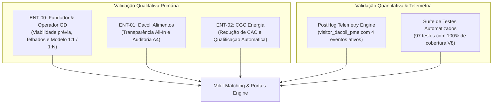

# Registro e Transcrição Estruturada de Entrevistas de Validação · N2 Milet

Este documento registra a base primária de validação qualitativa do problema e da tese de produto da Milet para as disciplinas de Projetos de Engenharia da Computação e Projetos Empreendedores (N2 - 2026).

---

## ENT-00 · Entrevista Fundacional & Desenvolvedor de Ativos de GD
- **Perfil do Entrevistado:** Desenvolvedor de Projetos de Geração Distribuída (GD) Solar & Originador de Ativos / Fundador da Plataforma.
- **Data e Método:** Novembro de 2026 · Relato primário de formulação de tese de mercado.
- **Segmento:** Oferta de Energia / Infraestrutura e Desenvolvimento de Usinas Fotovoltaicas.

### Depoimento Primário Bruto:
> *"Lembrando aqui o Milet iniciou com a ideia de que a gente teria achar basicamente demanda para usinas que a gente ia fazer. Então primeiro a gente precisava achar os telhados, que é um parceiro que tem telhados pra gente fazer usinas. Só que daí depois a gente precisava achar investidores. E por fim depois achar quais as melhores formas da gente estar até gerenciando nossa própria usina. Só que daí surgiu a ideia do milet, que é um passo um pouco até anterior. E daí meio que a gente gera demanda e gera depois estrutura pra estar vendendo energia. Então acho que isso é legal, né? Ter um lugar que dá pra gente até fazer um estudo prévio de viabilidade por lugares, geolocalização, expansão, clientes e ports, né? Pra tanto as usinas e os diferentes tipos de contrato que uma mesma usina pode ter, né? Que é de um pra um ou de um pra vários. E assim a gente ter mais uma noção disso, né?"*

### Síntese e Desdobramentos Técnicos:
1. **O Gargalo do Funil de Desenvolvimento:** O setor fotovoltaico tradicionalmente inicia a jornada buscando espaço físico (telhados/terrenos) e capital (investidores), incorrendo no risco crítico de ociosidade do ativo por ausência de demanda consumidora previamente contratada.
2. **Inversão da Tese (O "Passo Anterior"):** A Milet atua como a infraestrutura de inteligência que qualifica, padroniza e agrega a demanda de consumo (PMEs industriais e comerciais) *antes* da alocação de CAPEX na usina, reduzindo o custo de aquisição e garantindo previsibilidade de fluxo de caixa para o gerador.
3. **Modelagem Contratual Dual (1:1 vs. 1:N):**
   - **Contratos 1:1 (Autoconsumo Remoto / Arrendamento Dedicado):** Atendimento integral de uma única unidade consumidora com grande demanda contratada (ex: indústria alimentícia Grupo A4).
   - **Contratos 1:N (Geração Compartilhada / Consórcio ou Cooperativa):** Fracionamento da capacidade da usina em cotas para múltiplos consumidores do Grupo B ou A4, exigindo algoritmos de compensação escalonada e balanceamento contínuo de créditos junto à distribuidora.
4. **Requisitos de Software Implementados:**
   - Criação do **Portal de Usinas (`/portal/usinas`)** com cadastro de capacidade instalada (kWp), geração mensal (MWh/mês) e vinculação geográfica por concessionária local.
   - Implementação da função determinística `allocateConsumerToAsset` em `src/domain/matching-engine.ts`, que divide a quota de energia, aplica a curva de transição do Fio B (Lei 14.300/2022) e previne sobre-alocação do ativo.

---

## ENT-01 · Demanda PME Industrial
- **Identificação:** Guilherme, Proprietário.
- **Empresa:** Dacoli Alimentos (Indústria de alimentos, farináceos e grãos · Porto Feliz/SP).
- **Segmento:** Consumidor Grupo Tarifário A4 / B3 Industrial.
- **Síntese da Entrevista:**
  - Relatou dificuldade crônica de auditoria interna das faturas de energia elétrica, com flutuações sazonais imprevisíveis e complexidade na segregação de TUSD (demanda contratada e ponta/fora de ponta) vs. TE.
  - Demonstrou forte desconfiança em abordagens de vendedores de energia que prometem "descontos milagrosos de 20% a 30%" sem explicitar custos de migração, encargos setoriais e taxas de corretagem.
  - **Requisito Derivado:** Equalização *All-In* transparente no **Portal do Consumidor (`/portal/consumidor`)**, com cálculo matemático auditável que destaca a taxa neutra da Milet (0,5%) e compara o custo total real antes de qualquer assinatura.

---

## ENT-02 · Fornecedor / GD por Assinatura
- **Identificação:** Gerente de Novos Negócios.
- **Empresa:** CGC Energia (Geração distribuída e energia solar por assinatura · São José do Rio Preto/SP).
- **Segmento:** Fornecedor / Gerador de Energia Compartilhada.
- **Síntese da Entrevista:**
  - Apontou que a principal barreira para escalar a carteira de usinas solares é o elevadíssimo Custo de Aquisição de Clientes (CAC) no segmento PME.
  - O processo comercial de coletar faturas físicas, interpretar dados incompletos ou ilegíveis e formatar propostas personalizadas consome dias e gera alta taxa de abandono do lead.
  - **Requisito Derivado:** Criação do pipeline de **OCR automatizado via Gemini Multimodal** e do **Portal da Comercializadora/Geradora (`/portal/comercializadora`)**, que entrega leads pré-qualificados com dados elétricos limpos, consentimento LGPD registrado e mascaramento preventivo de PII (`maskLeadForSupplier`).

---

## Triangulação Metodológica de Validação (N2)

